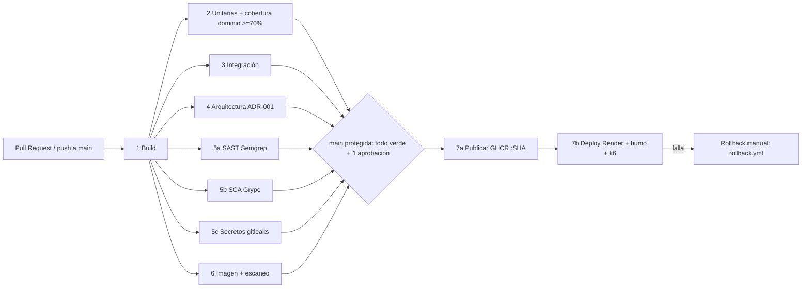

# DevOps — pipeline de entrega continua y segura de CampusFix

Todo el pipeline vive en `.github/workflows/`. La evidencia son las ejecuciones en la pestaña **Actions**.

## 1. Vista general



Cada etapa es un *job* independiente y un **check requerido** en la protección de `main`: si cualquiera falla, el PR no se puede integrar.
Los jobs 2–6 corren en paralelo para que el pipeline dure < 10 min (caché de Maven con `setup-java cache: maven` y caché de capas Docker con `type=gha`).

## 2. Etapas, qué verifican y qué las detiene

| # | Job (`ci.yml`/`cd.yml`) | Qué hace | Umbral que detiene el pipeline | Reporte (artifact) |
|---|---|---|---|---|
| 1 | `build` | `mvn package` + copia de dependencias | Error de compilación | `build-output` |
| 2 | `unit-tests` | `mvn verify` (unitarias + JaCoCo) | Test rojo **o** cobertura de líneas del dominio < 70 % (regla `check` de JaCoCo en `pom.xml`) | `reportes-pruebas-y-cobertura` |
| 3 | `integration-tests` | Failsafe: `FlujoHttpIT`, JDBC, QR | Test de integración rojo | `reportes-integracion` |
| 4 | `architecture` | `ArquitecturaTest` (reglas de dependencia del ADR-001) | Cualquier regla violada | `reporte-arquitectura` |
| 5a | `security-sast` | Semgrep (`p/java`, `p/owasp-top-ten`) | Hallazgo severidad ERROR (alta/crítica) sin tratar | `reporte-sast` (SARIF) |
| 5b | `security-sca` | Grype sobre `target/lib` | CVE alta/crítica **con parche disponible** | `reporte-sca` |
| 5c | `security-secrets` | gitleaks sobre el historial | Cualquier secreto | `reporte-secretos` |
| 6 | `image` | Build del Dockerfile + Grype sobre la imagen + humo local | CVE crítica con parche; contenedor no sano | `reporte-imagen` |
| 7a | `publicar` | Push a `ghcr.io/jcstevez/campusfix:<SHA>` | Fallo de login/push | — |
| 7b | `desplegar` | Deploy, espera de `/salud`, humo, k6 con umbrales | `/salud` no responde; humo ≠ 2xx; umbral k6 (`perf/scripts/despliegue.js`) roto | `reporte-k6-despliegue` |

### Reglas de arquitectura como prueba (etapa 4)
`ArquitecturaTest` exige, entre otras: (R1) el dominio no depende de `application`, `adapter` ni `bootstrap`; (R2) el dominio y la aplicación no importan tecnología (HTTP, JDBC, Jackson, ZXing); (R3) `adapter.in` no depende de `adapter.out` y viceversa; (R4) ningún adaptador depende de `bootstrap`. Son las reglas de dependencia declaradas en `docs/adr/ADR-001-arquitectura-hexagonal.md`.

### Evidencia: PR bloqueado por la regla de arquitectura
Se abrio el PR #20 (https://github.com/Jcstevez/CampusFix/pull/20), que agrega en `Prioridad.java` (dominio) un `import` de `com.campusfix.application.Canal`. El job 4 fallo con `ArquitecturaTest.elNucleoNoDependeDeAplicacionAdaptadoresNiBootstrap`: "El paquete domain rompe la regla de dependencia ... Prioridad.java -> com.campusfix.application.Canal" (Tests run: 8, Failures: 1). Run: https://github.com/Jcstevez/CampusFix/actions/runs/43943987618. El PR se cerro sin integrar y `main` no cambio.

## 3. Entrega y despliegue
* **Imagen:** se publica en GHCR etiquetada con el **SHA** del commit (nunca solo `latest`); al crear un tag `vX.Y.Z` (`release.yml`) se publica además con la versión y se crea el Release en GitHub.
* **Despliegue automático:** `cd.yml` se dispara cuando el CI de `main` termina en verde. Llama al *Deploy Hook* de Render con `imgURL=<imagen:SHA>`. Ver ADR-002.
* **Secretos:** `RENDER_DEPLOY_HOOK_URL` es un *secret* del Environment `production`; `APP_URL` es una *variable* del mismo Environment. Nada sensible está en el repositorio ni en el historial (lo verifica gitleaks).
* **Smoke + carga:** tras el despliegue se espera `/salud`, se ejecuta el humo y un k6 corto de 30 s con umbrales del SLO (`http_req_failed<1 %`, `p95<500 ms`).
* **Rollback:** workflow `Rollback` (manual) → `Actions → Rollback → Run workflow → version = <SHA o vX.Y.Z anterior>`; vuelve a desplegar esa imagen y verifica `/salud`. Se ejecutó una vez como evidencia: [Rollback #1](https://github.com/Jcstevez/CampusFix/actions/runs/43961398035).

## 4. Flujo de trabajo (GitHub Flow)
Ramas cortas `feature/*`, `fix/*` → Pull Request a `main` → checks verdes + **1 aprobación de otro integrante** → *squash merge*. `main` está protegida (Settings → Branches). Versionado semántico con tags `vMAJOR.MINOR.PATCH`; cambios en `CHANGELOG.md`.

## 5. Cómo ejecutar lo mismo en local
```bash
mvn verify                                  # etapas 1–3 + umbral de cobertura
mvn test -Dtest=ArquitecturaTest            # etapa 4
docker build -t campusfix:local . && docker compose up   # etapa 6/7 en local
k6 run -e BASE_URL=http://localhost:8080 perf/scripts/despliegue.js
```

## 6. Medición del pipeline
Duración de la última ejecución verde de `main`: 3 min 3 s (meta < 10 min), run #7 del PR #7.
